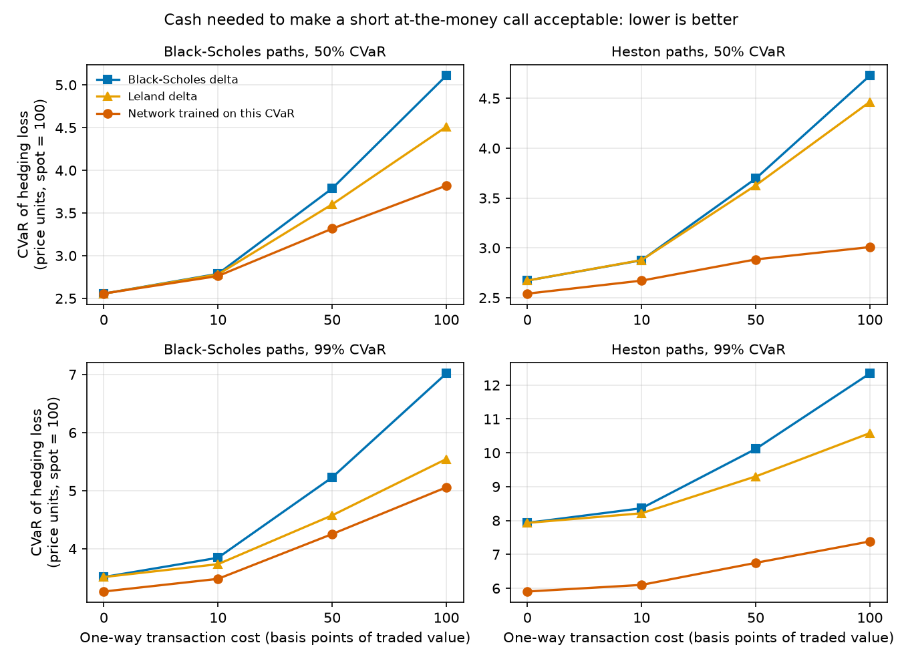

# Hedgerow

**What a hedge costs when you can only trade now and then, and whether a neural network does it better.**

## Result

On the risk measure it is trained on, the network beats Leland's hedge in 15 of 16 cases: two worlds, four cost levels, two CVaR levels, 200,000 fresh test paths each. The one exception is Black-Scholes paths with no costs, where there is nothing to beat and it lands 0.001 above the formula. At 50 basis points of cost the 50% CVaR of the hedging loss on a call worth 2.29 is 3.32 for the network and 3.60 for Leland on Black-Scholes paths, and 2.89 against 3.63 on Heston paths.

The win is narrower than that sounds. On Black-Scholes paths Leland has the smaller standard deviation at every positive cost (0.42 against 0.63 at 50 bp). A network trained on the 50% CVaR has a worse 99% CVaR than Leland at every cost level, and at 100 bp it is worse than the plain Black-Scholes delta. Much of the network's edge is cost it does not pay: at 50 bp it trades about half as many shares as Leland.



Each point is the cash that makes the short call acceptable under that CVaR, before any premium. Lower is better. The network in each panel was trained on that panel's CVaR level.

| Paths | Cost (bp, one way) | CVaR level | Black-Scholes delta | Leland | Network | Network minus Leland |
| --- | ---: | ---: | ---: | ---: | ---: | ---: |
| Black-Scholes | 0 | 50% | 2.555 | 2.555 | 2.556 | +0.001 ± 0.000 |
| Black-Scholes | 10 | 50% | 2.787 | 2.781 | 2.762 | −0.019 ± 0.000 |
| Black-Scholes | 50 | 50% | 3.787 | 3.601 | 3.316 | −0.285 ± 0.001 |
| Black-Scholes | 100 | 50% | 5.109 | 4.510 | 3.821 | −0.689 ± 0.003 |
| Black-Scholes | 0 | 99% | 3.515 | 3.515 | 3.266 | −0.249 ± 0.009 |
| Black-Scholes | 10 | 99% | 3.847 | 3.737 | 3.484 | −0.253 ± 0.009 |
| Black-Scholes | 50 | 99% | 5.229 | 4.576 | 4.254 | −0.322 ± 0.009 |
| Black-Scholes | 100 | 99% | 7.017 | 5.545 | 5.058 | −0.487 ± 0.010 |
| Heston | 0 | 50% | 2.673 | 2.673 | 2.542 | −0.131 ± 0.004 |
| Heston | 10 | 50% | 2.876 | 2.878 | 2.672 | −0.206 ± 0.004 |
| Heston | 50 | 50% | 3.695 | 3.627 | 2.885 | −0.742 ± 0.006 |
| Heston | 100 | 50% | 4.727 | 4.464 | 3.008 | −1.456 ± 0.008 |
| Heston | 0 | 99% | 7.931 | 7.931 | 5.905 | −2.026 ± 0.041 |
| Heston | 10 | 99% | 8.363 | 8.214 | 6.100 | −2.115 ± 0.040 |
| Heston | 50 | 99% | 10.114 | 9.302 | 6.751 | −2.552 ± 0.044 |
| Heston | 100 | 99% | 12.342 | 10.581 | 7.383 | −3.198 ± 0.047 |

Short one at-the-money call, spot 100, 30 days, 30 daily rebalances, zero rates. Loss is in price units. The ± is one standard error of the paired difference over 20 blocks of test paths. With no costs the Leland delta is the Black-Scholes delta. The full table, with mean, standard deviation, costs paid and shares traded for every strategy, is in [results/comparison.md](results/comparison.md).

These numbers were produced on a CPU (Intel Core i9-13900K, one thread, PyTorch 2.15.0 CPU build). The full run took 19 minutes.

## Reproduce

```
uv sync
uv run python scripts/reproduce.py
```

This rebuilds every file in `results/`. A second run on the same machine gives the same files byte for byte. `uv run python scripts/reproduce.py --fast` is a 30 second smoke run that writes to `build/results-fast/`; its numbers are not the committed ones.

`pyproject.toml` pins the CPU build of PyTorch. The code takes `--device cuda` if you install a CUDA build yourself, but that path has not been run and its numbers would differ in the last digits.

## The question

The textbook hedge assumes you trade continuously and for free. You do neither. How large is the error, and can a network trained on the real costs beat the classical fix?

## What was built

- Delta hedging at discrete intervals, with the hedging error measured against theory
- Proportional transaction costs and Leland's adjusted volatility
- A deep-hedging network trained under the same costs with a CVaR objective
- All strategies scored on identical paths: first Black-Scholes, then Heston paths the classical hedge was not built for

The network is small: three hidden layers of 32 units, shared across all dates, taking moneyness, time left, its own previous holding and (on Heston paths) the current variance. It trades the stock only.

## What else was measured

Discrete hedging with no costs. The standard deviation of the hedging error falls from 0.84 with 5 rebalances to 0.09 with 500. The fitted log-log slope is −0.485 against the theoretical −0.5. See [results/discretisation.md](results/discretisation.md).


One rebalance interval. The gain of a hedged long option over one interval is λ(u² − 1), with u standard normal and λ = ½ΓS²σ²Δt: a loss in 68.1% of intervals (68.3% predicted), never worse than −λ, with the occasional large gain.


Leland under costs. At 50 bp, a Black-Scholes hedger who charges the Black-Scholes price loses 0.86 on average with 30 rebalances and 3.56 with 500. A Leland hedger who charges the Leland price is within 0.06 of break-even at every rebalance count from 5 to 500. See [results/leland.md](results/leland.md).


What the network learned. With no costs it reproduces the Black-Scholes delta. With costs it stays put when its holding is already near the Leland delta, and moves only part of the way when it is far from it.


The loss distributions at 50 bp are in [results/fig_loss_distribution.png](results/fig_loss_distribution.png), and the spread across three training seeds in [results/seeds.md](results/seeds.md).

## Sources

- Boyle and Emanuel, "Discretely adjusted option hedges", Journal of Financial Economics 8(3), 1980
- Leland, "Option Pricing and Replication with Transactions Costs", Journal of Finance 40(5), 1985
- Buehler, Gonon, Teichmann and Wood, "Deep hedging", Quantitative Finance 19(8), 2019 (arXiv 1802.03042)
- Kabanov and Safarian, "On Leland's strategy of option pricing with transactions costs", Finance and Stochastics 1, 1997
- Kamal and Derman, "When You Cannot Hedge Continuously: The Corrections to Black-Scholes", Goldman Sachs Quantitative Strategies Research Notes, 1998

The first two are behind paywalls and were not read. Leland's formula is taken from Kabanov and Safarian, who restate it. The Boyle and Emanuel result is derived in `PAPER.md` and checked by simulation. The last two were added as sources for that reason.

## Comparison with the sources

Full detail, with equation numbers, is in [PAPER.md](PAPER.md).

- The deep hedging paper's Heston call price of 1.69 comes out at 1.702 ± 0.002 here.
- Its finding that a costless 50% CVaR network sits close to the model hedge holds on Black-Scholes paths (2.556 against 2.555).
- Derman and Kamal's rule of thumb for the hedging error, √(π/4) × vega × σ/√N, is within 4% of the simulation at 30 rebalances.
- Their printed simulation does not replicate. They report a standard deviation of 0.41 with 21 rebalances and 0.20 with 84. The same setup here gives 0.428 and 0.218. The cause was not found.
- The paper hedges Heston with a variance swap as well as the stock. This repository trades the stock only, so its Heston numbers cannot be set beside the paper's.
- Kabanov and Safarian prove that Leland's hedging error does not vanish as rebalancing gets more frequent at a fixed cost rate. Up to 500 rebalances the error here is still shrinking, so this run does not test their theorem.

## Data

Simulated paths only. Nothing is downloaded, so there is no `scripts/fetch_data.py`.

## How it is tested

71 tests. The maths is tested before any result is trusted.

- Hedging error shrinks as one over the square root of the number of rebalances
- With zero costs the network recovers the Black-Scholes delta
- The same seed gives the same paths to every strategy
- Black-Scholes prices against a textbook value and against Derman and Kamal's printed price and vega; put-call parity; Greeks against finite differences
- Heston simulator against the closed-form mean and variance of the variance process, the variance swap value, and the paper's call price
- CVaR as the minimum of the paper's objective, and against the normal closed form
- The network's own loss against the numpy accounting used for every other strategy
- Running the whole pipeline twice gives byte-identical files

```
uv run pytest
uv run ruff check
uv run mypy src
```

## Layout

```
src/hedgerow/      the code
tests/             maths tests first
scripts/reproduce.py   one command rebuilds every figure and table
results/           committed figures and small tables
PAPER.md           citations, formulas, claims tested, comparison with the sources
```

## Roadmap

- [x] Project skeleton, CI, and the reproduce command
- [x] Delta hedging at discrete intervals, with the hedging error measured against theory
- [x] Proportional transaction costs and Leland's adjusted volatility
- [x] A deep-hedging network trained under the same costs with a CVaR objective
- [x] All strategies compared on identical paths: first Black-Scholes, then Heston paths the classical hedge was not built for
- [x] `PAPER.md` comparison with the sources
- [x] Results and limits written up at the top of this file

The CI workflow is written but has not run on GitHub.

## Limits

- A network that wins on simulated paths has learned the simulator. Real markets are not the simulator. Every network here was trained and tested on paths from the same model with the same parameters. Nothing here trains on one model and tests on another.
- The network wins on the measure it was trained on and can lose badly on others. Trained on the 50% CVaR at 100 bp, it has a 99% CVaR of 7.13 on Black-Scholes paths, against 5.55 for Leland.
- Leland was not designed to minimise CVaR. It targets the mean and gets a small standard deviation with it. On standard deviation it beats both networks on Black-Scholes paths at every positive cost.
- The Heston parameters are the paper's, with a volatility of variance of 2. In that world the variance is near zero at expiry on 69% of paths. The size of the network's Heston advantage belongs to that extreme setting.
- On Heston paths the network sees the current variance, which a real hedger does not observe. The Leland and Black-Scholes hedges use a fixed 20% volatility. A formula hedge that is also given the current variance is in the full table: it has a better 99% CVaR than Leland but the network trained on the 99% CVaR still beats it at every cost level.
- One contract: a 30 day at-the-money call, rebalanced daily. One network size. No search over architectures.
- Training longer helps a little. Going from 2,000 to 6,000 steps lowered one network's CVaR by 0.6% in a trial, so the networks here are slightly undertrained.
- The original Leland and Boyle and Emanuel papers were not read.
- This is research code. It is not investment advice and it does not trade.

## The name

A hedgerow is a hedge that took years to grow and still has gaps in it.

## Licence

MIT. See `LICENSE`.
