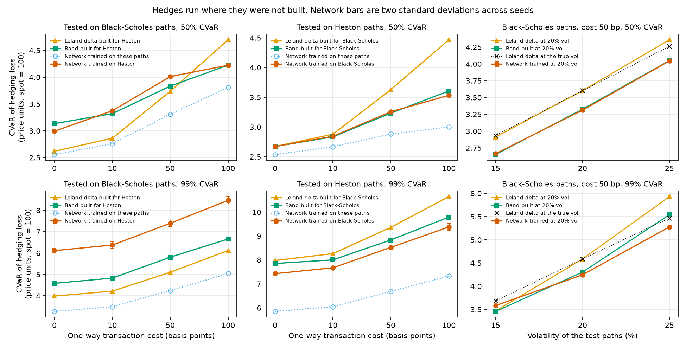
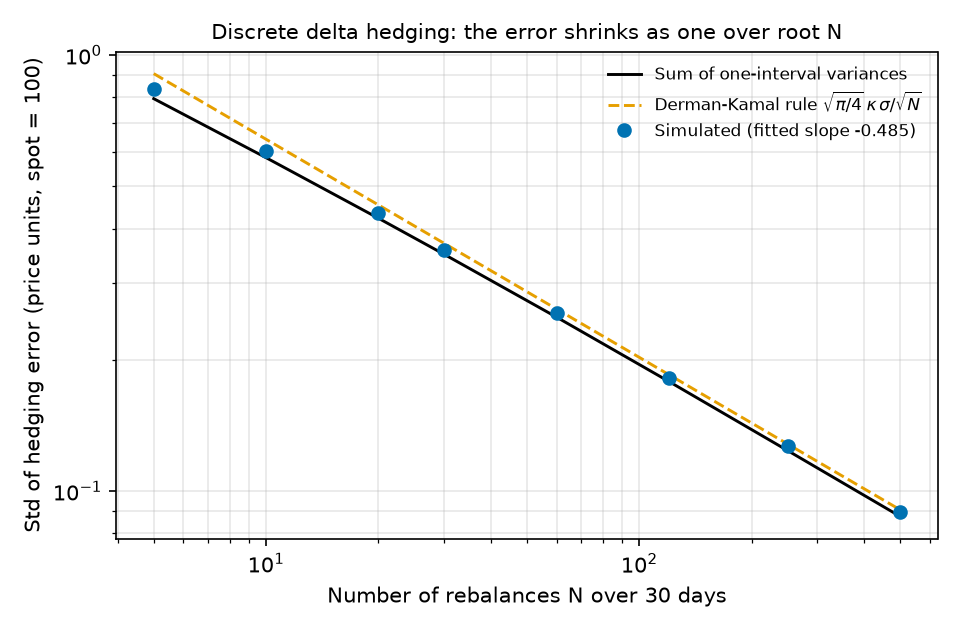
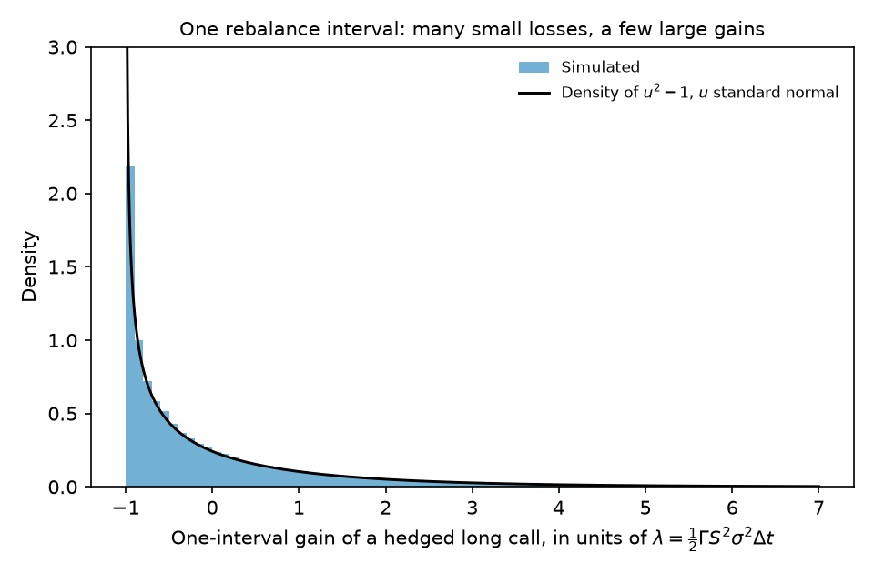
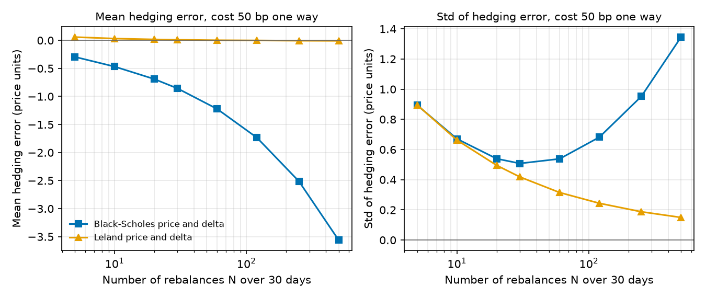
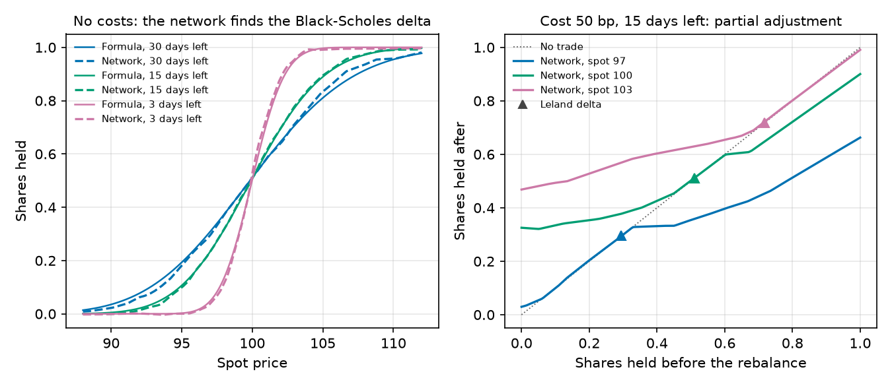

# Hedgerow

Can a neural network hedge a short call under transaction costs better than the formulas can?

## Result

A little, and less than the first version of this repository said. Against Leland's hedge the network is lower in 15 of 16 cases and ties one. Against a formula delta with a no-trade band it is lower in 12 and ties 4, and most of the gap is gone. On Black-Scholes paths at 50 basis points of cost, the 50% CVaR of the hedging loss is 3.602 for Leland, 3.327 for the band and 3.313 for the network. The network's 0.014 edge over the band is smaller than the 0.015 spread between five training seeds, so it counts as a tie.

On Heston paths the network keeps a real edge: 2.882 against 2.994 for the band at the same cost and level, and about 0.3 at the 99% level at every cost. That edge only holds in the world the network was trained in. A network trained on Heston paths and run on Black-Scholes paths has a 99% CVaR between 6.1 and 8.5, where the band built for Heston gives 4.6 to 6.7.


Each point is the cash that makes the short call acceptable under that CVaR, before any premium. Lower is better. The network in each panel was trained on that panel's CVaR level.

| Paths | Cost (bp, one way) | CVaR level | Leland | Band | Network | Network minus band | Lower |
| --- | ---: | ---: | ---: | ---: | ---: | ---: | ---: |
| Black-Scholes | 0 | 50% | 2.556 | 2.556 | 2.556 ± 0.000 | −0.000 ± 0.000 | tie |
| Black-Scholes | 10 | 50% | 2.782 | 2.758 | 2.759 ± 0.001 | +0.001 ± 0.001 | tie |
| Black-Scholes | 50 | 50% | 3.602 | 3.327 | 3.313 ± 0.015 | −0.014 ± 0.015 | tie |
| Black-Scholes | 100 | 50% | 4.511 | 3.856 | 3.809 ± 0.012 | −0.047 ± 0.012 | network |
| Black-Scholes | 0 | 99% | 3.520 | 3.503 | 3.269 ± 0.002 | −0.234 ± 0.008 | network |
| Black-Scholes | 10 | 99% | 3.742 | 3.676 | 3.487 ± 0.002 | −0.188 ± 0.007 | network |
| Black-Scholes | 50 | 99% | 4.586 | 4.305 | 4.246 ± 0.008 | −0.059 ± 0.010 | network |
| Black-Scholes | 100 | 99% | 5.557 | 5.039 | 5.044 ± 0.008 | +0.004 ± 0.010 | tie |
| Heston | 0 | 50% | 2.647 | 2.567 | 2.537 ± 0.000 | −0.030 ± 0.003 | network |
| Heston | 10 | 50% | 2.872 | 2.710 | 2.668 ± 0.001 | −0.042 ± 0.002 | network |
| Heston | 50 | 50% | 3.683 | 2.994 | 2.882 ± 0.002 | −0.112 ± 0.004 | network |
| Heston | 100 | 50% | 4.578 | 3.196 | 3.002 ± 0.002 | −0.194 ± 0.003 | network |
| Heston | 0 | 99% | 8.555 | 6.134 | 5.853 ± 0.003 | −0.280 ± 0.016 | network |
| Heston | 10 | 99% | 8.858 | 6.342 | 6.050 ± 0.003 | −0.292 ± 0.016 | network |
| Heston | 50 | 99% | 10.031 | 6.993 | 6.687 ± 0.007 | −0.306 ± 0.020 | network |
| Heston | 100 | 99% | 11.416 | 7.644 | 7.328 ± 0.013 | −0.316 ± 0.023 | network |

Short one at-the-money call, spot 100, 30 days, 30 daily rebalances, zero rates. The call is worth 2.29 on Black-Scholes paths and 1.69 on Heston paths. Loss is in price units, on 200,000 test paths per world. The network column is the mean of five training seeds with their standard deviation. The ± on the difference is the noise in one trained network: seed spread and test-set error combined. A cell goes to the network or the formula only when the mean difference is more than twice that noise. The same table with all three comparisons is [results/headline.md](results/headline.md), and every strategy's mean, standard deviation, costs and turnover are in [results/comparison.md](results/comparison.md).

The main limit: everything here is simulated, one contract, one small network. The band baseline is a constant-width band, which is simpler than the bands in the transaction-cost literature. A better band would narrow the gap further.

## What the first version got wrong

The first version reported a win in 15 of 16 cells against Leland and gave the Black-Scholes 50 bp gap as −0.285 ± 0.001. Three things were wrong with that.

The ± counted only the finite test set. It left out the change from one training run to the next. Five seeds at that cell give a CVaR between 3.294 and 3.333, a spread fifteen times the quoted error. Every cell is now trained with five seeds and judged against both sources of noise.

On Heston paths the Leland and Black-Scholes hedges used 20% volatility, while the call there is worth 1.69, an implied volatility of 14.79%. That was a mis-specified baseline. Fixing it did not rescue Leland: at the implied volatility its 50% CVaR is about the same and its 99% CVaR is worse (10.03 against 9.36 at 50 bp). The Heston results now also include the Heston delta and the Heston minimum-variance delta, which a hedger who knows the model would use.

Leland was the only cost-aware baseline, and it is a weak one for this objective. It trades every day. A formula delta inside a no-trade band trades about as little as the network does (1.08 shares against 1.11 at 50 bp on Black-Scholes paths, where Leland trades 1.99) and takes back most of the gap. The first version's README also gave the call value as 2.29 for both worlds.

## Run in the wrong model

Every strategy above was scored in the world it was built for. This section runs them where they were not built, with nothing refitted.



Trained on Black-Scholes, tested on Heston. The network holds up about as well as the formulas built for Black-Scholes. Against the band it is lower in 5 of 8 cells, ties 1 and loses 2 by 0.02 or less. All of them are well behind anything built for Heston: at 50 bp the Black-Scholes network has a 50% CVaR of 3.257 on Heston paths, against 2.882 for the network trained there.

Trained on Heston, tested on Black-Scholes. The network does badly. It was trained with the variance as an input, in a world where variance swings between near zero and several times its mean, and it is then told a constant 0.04. It loses to the band built for Heston in 6 of 8 cells, by 1.5 to 1.8 at the 99% level, and the plain Leland delta at the Heston implied volatility beats it in 7 of 8.

Trained at 20% volatility, tested at 15% and 25%. Against the band the count is 7 lower, 2 ties, 7 higher. The 99% network loses all four cost levels at 15% volatility and wins all four at 25%. The 50% networks stay within 0.05 of the band at both volatilities.

Trained at one cost, charged another. The network and the band degrade at a similar rate on Black-Scholes paths. A network built for free trading and charged 100 bp has a 50% CVaR of 5.14 there, about the same as the plain delta's 5.11. On Heston paths the same mismatch gives 5.33 for the network and 4.40 for the band.

Tables: [cross_world.md](results/cross_world.md), [vol_shift.md](results/vol_shift.md), [cost_shift.md](results/cost_shift.md).

## How the comparison is set up

Each world has three sets of 200,000 paths from different seeds. Networks train on the first. Choices are made on the second, the validation set: the training length, and the target and width of each no-trade band. The third is the test set and is only scored. The validation set is the first version's test set. The test set is a new draw that no earlier run touched.

Training length was picked from three options per CVaR level on validation paths ([training_length.md](results/training_length.md)). The longest won at both levels, 6,000 and 4,000 steps, so longer training might still help the network a little. The learning rate, batch sizes and network size were fixed during unrecorded trials before the first version. They were not chosen on validation paths and should be read as post hoc choices.

The formula hedges, by world:

- Black-Scholes: the delta and the Leland delta at 20%.
- Heston: the Black-Scholes delta and the Leland delta at the implied volatility, the Black-Scholes delta with the current variance plugged in, the Heston delta, and the Heston minimum-variance delta.
- Both: a no-trade band around one of those deltas. The hedger holds still while within a fixed number of shares of the target and otherwise trades to the edge. Target and width are chosen on validation paths for each cost and CVaR level ([bands.md](results/bands.md)).

The network is three hidden layers of 32 units, shared across all dates. It sees moneyness, time left, its own previous holding and, on Heston paths, the current variance. It trades the stock only.

## Reproduce

```
uv sync
uv run python scripts/reproduce.py --workers 8
```

This rebuilds every file in `results/`. It trains 104 networks, each on one CPU thread, which is about three hours of CPU time. `--workers` spreads the training over processes and does not change any number. A second run on the same machine gives the same files byte for byte; the committed files were checked that way. `uv run python scripts/reproduce.py --fast` is a smoke run of a minute or two that writes to `build/results-fast/`. Its numbers are not the committed ones.

The committed run was made on an Intel Core i9-13900K with the CPU build of PyTorch 2.15.0. It took 91 minutes with 8 workers while a second copy ran beside it.

`pyproject.toml` pins the CPU build of PyTorch. The code takes `--device cuda` if you install a CUDA build yourself, but that path has not been run.

## What else was measured

Discrete hedging with no costs. The standard deviation of the hedging error falls from 0.84 with 5 rebalances to 0.09 with 500. The fitted log-log slope is −0.485 against the theoretical −0.5. See [results/discretisation.md](results/discretisation.md).



One rebalance interval. The gain of a hedged long option over one interval is λ(u² − 1), with u standard normal and λ = ½ΓS²σ²Δt. It is a loss in 68.1% of intervals (68.3% predicted) and never worse than −λ.



Leland under costs. At 50 bp, a Black-Scholes hedger who charges the Black-Scholes price loses 0.86 on average with 30 rebalances and 3.56 with 500. A Leland hedger who charges the Leland price is within 0.06 of break-even at every rebalance count from 5 to 500. See [results/leland.md](results/leland.md).



What the network learned. With no costs it reproduces the Black-Scholes delta. With costs it stays put when its holding is already near the Leland delta, and moves only part of the way when it is far from it. That is close to what a no-trade band does, which fits the tie between the two.



The loss distributions at 50 bp are in [results/fig_loss_distribution.png](results/fig_loss_distribution.png), and every network's result by seed is in [results/seeds.md](results/seeds.md).

## Sources

- Boyle and Emanuel, "Discretely adjusted option hedges", Journal of Financial Economics 8(3), 1980
- Leland, "Option Pricing and Replication with Transactions Costs", Journal of Finance 40(5), 1985
- Buehler, Gonon, Teichmann and Wood, "Deep hedging", Quantitative Finance 19(8), 2019 (arXiv 1802.03042)
- Kabanov and Safarian, "On Leland's strategy of option pricing with transactions costs", Finance and Stochastics 1, 1997
- Kamal and Derman, "When You Cannot Hedge Continuously: The Corrections to Black-Scholes", Goldman Sachs Quantitative Strategies Research Notes, 1998

The first two are behind paywalls and were not read. Leland's formula is taken from Kabanov and Safarian, who restate it. The Boyle and Emanuel result is derived in `PAPER.md` and checked by simulation. The Heston characteristic function was written from memory of the standard form and checked numerically. [PAPER.md](PAPER.md) has the formulas, equation numbers and a claim-by-claim comparison.

- The deep hedging paper's Heston call price of 1.69 comes out at 1.692 by Fourier inversion. The mean payoff on the 200,000 simulated test paths is 1.705.
- Its finding that a costless 50% CVaR network sits close to the model hedge holds on Black-Scholes paths (2.556 for both).
- Derman and Kamal's rule of thumb for the hedging error, √(π/4) × vega × σ/√N, is within 4% of the simulation at 30 rebalances.
- Their printed simulation does not replicate. They report a standard deviation of 0.41 with 21 rebalances and 0.20 with 84. The same setup here gives 0.428 and 0.218. The cause was not found.
- The paper hedges Heston with a variance swap as well as the stock. This repository trades the stock only, so its Heston numbers cannot be set beside the paper's.

## How it is tested

86 tests, run with lint and type checks on every push.

- Hedging error shrinks as one over the square root of the number of rebalances
- With zero costs the network recovers the Black-Scholes delta
- Black-Scholes prices against a textbook value and against Derman and Kamal's printed price and vega; put-call parity; Greeks against finite differences
- Heston simulator against the closed-form mean and variance of the variance process and the paper's call price
- Heston Fourier price against the paper's 1.69, the simulator and the Black-Scholes limit; both deltas against finite differences of the price
- The no-trade band on a hand-worked example, and its choice as the validation minimum
- The win rule: a gap inside seed noise is a tie
- The network's own loss against the numpy accounting used for every other strategy
- Running the pipeline twice, and with one or two worker processes, gives identical output

```
uv run pytest
uv run ruff check
uv run mypy src
```

## Layout

```
src/hedgerow/          black_scholes, paths, heston, hedging, risk, deep, experiments, report
tests/                 one file per module
scripts/reproduce.py   one command rebuilds every figure and table
results/               committed figures and tables
PAPER.md               formulas, sources, claims tested, what was chosen and when
```

Simulated paths only. Nothing is downloaded.

## Limits

- A network that does well on simulated paths has learned the simulator. The wrong-model runs above show how far that carries: reasonably from Black-Scholes to Heston, badly the other way.
- The band has a constant width chosen from 15 values. The bands in the literature widen with gamma. The grid first stopped at 0.3 shares, and two Heston cells picked 0.3, so it was extended to 1.0 after that run. That change was made after seeing results and it made the baseline stronger.
- A network is good on the measure it was trained on and can be poor on others. Trained on the 50% CVaR at 100 bp, it has a 99% CVaR of 6.88 on Black-Scholes paths, against 5.56 for Leland.
- Leland targets the mean and keeps the standard deviation small. On Black-Scholes paths it has the smallest standard deviation of any strategy at every positive cost (0.42 at 50 bp, against 0.63 for the band and 0.65 for the network).
- On Heston paths at 50 bp and above, not hedging at all has a lower 50% CVaR (3.21) than any formula delta that trades daily. The band and the network win there mainly by trading little.
- The Heston parameters are the deep hedging paper's, with a volatility of variance of 2. The variance is near zero at expiry on 69% of paths. The size of the Heston gaps belongs to that extreme setting. No other Heston parameters were tried, and Heston-trained networks were not tested on Heston paths with shifted parameters.
- The network and the Heston formula hedges see the current variance, which a real hedger does not observe.
- The Heston deltas come from the continuous-time model. The simulator holds the variance fixed within each day, so the two differ slightly (call value 1.692 against a simulated 1.705).
- One contract: a 30 day at-the-money call, rebalanced daily. One network size. No search over architectures.
- This is research code. It is not investment advice and it does not trade.

A hedgerow is a hedge that took years to grow and still has gaps in it.

## Licence

MIT. See `LICENSE`.
